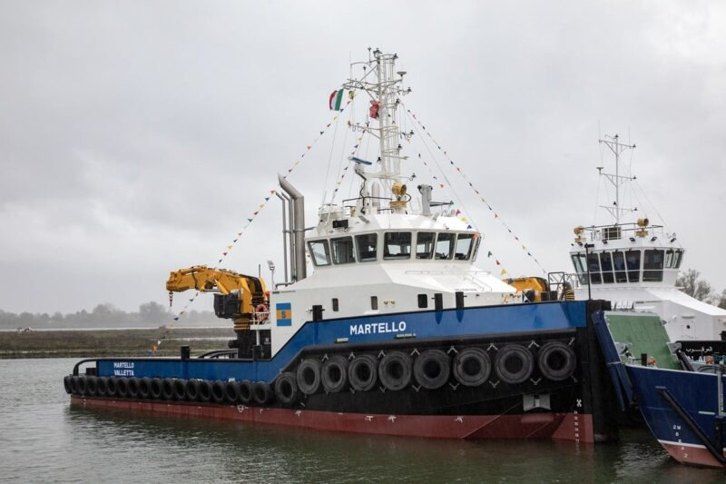

# Schipper naast God

Een schip begint niet zomaar aan zijn eerste reis. Dat merkte ik toen ik op een maandagochtend werd gevraagd om een nieuw schip te zegenen. Een Italiaanse reder had een schip laten bouwen in Gorinchem, bij scheepsbouwer Damen. De opdrachtgever wilde graag dat het schip, de Martello, voordat zij in gebruik werd genomen, de zegen van God zou ontvangen. 

Zo stapte ik een voor mij totaal onbekende wereld binnen: die van de grote scheepsbouw. Een indrukwekkende wereld van staal, techniek en enorme schepen. <!-- more -->

Het was slecht weer, maar volgens een oud bijgeloof mocht er absoluut geen paraplu aan boord komen! Wat mij vooral raakte, was het geloof en het vertrouwen waarmee men Gods zegen over het schip vroeg. 

{ class="martello" align=left width="240" } **Inzegening van het schip de Martello**  

Bij de zegening las ik het evangelieverhaal over Jezus en zijn leerlingen in een boot. Terwijl Jezus ligt te slapen, steekt er een hevige storm op. De leerlingen raken in paniek en roepen: ‘Heer, Heer, wij vergaan!’ Jezus staat op en brengt de storm tot
bedaren.

Het schip en haar bemanning zullen ongetwijfeld met stormen en hoge golven te maken krijgen. Hoe belangrijk is het dan om vertrouwen te hebben! Maar lijken wij niet ook op de leerlingen van Jezus? Ook in ons leven kan er tegenwind zijn, alsof het water ons tot aan de lippen staat. En dan kunnen we ons afvragen waar God is.
Het lijkt dan wel alsof Hij slaapt. 

Juist dan mogen we erop vertrouwen dat Hij bij ons is. Ook als wij Hem niet ervaren, is Hij niet ver weg. Hij gaat met ons mee en laat ons niet alleen. 

De ervaring op die scheepswerf was bijzonder. Wat mooi dat deze scheepslieden Gods zegen vragen over hun leven en werkplek. Maar dat mag natuurlijk ook gelden voor landrotten en alle andere mensen. 

We weten niet welke wateren we nog zullen bevaren en welke stormen we onderweg tegenkomen. Maar we mogen erop vertrouwen dat God met ons meegaat.

Schipper naast God. Dat is meer dan een mooie uitdrukking. Het is een uitnodiging om met vertrouwen onze levensweg te gaan.

Goede vaart ook in 2027!

Pastoor Meijer